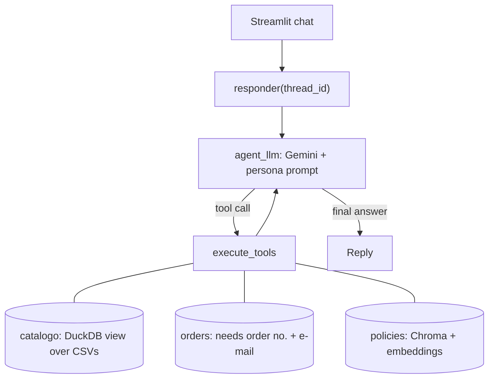

# Empório da Música: Customer Service Agent

A prototype customer-service agent for Empório da Música, a fictional musical-instrument store in
Campo Grande, Brazil. Built for the Artefact AI Engineer technical case. The agent speaks as the
store's persona (in Portuguese, since its customers are Brazilian), queries **data** (prices,
stock, promotions, orders) and **policies** (returns, payment, hours), and politely declines
off-topic requests.

## Quick start

Requirements: Python 3.11+ (tested on Windows, Python [CONFIRM: 3.13 / 3.14]) and a free
[Google AI Studio](https://aistudio.google.com/apikey) API key.

```bash
git clone https://github.com/wallacemattos-dados && cd emporio_ai_agent
python -m venv venv
source venv/bin/activate            # Windows PowerShell: venv\Scripts\Activate.ps1
pip install -r requirements.txt
cp .env.example .env                # Windows: Copy-Item .env.example .env
```

Edit `.env`:

```text
GOOGLE_API_KEY=your_key
LLM_MODEL=[CONFIRM: exact model id used]
EMBEDDING_MODEL=gemini-embedding-001
```

Run the chat UI: `streamlit run frontend.py`
Run the tests (offline, no API key used): `pip install -r requirements-dev.txt && python -m pytest -q`

> **Free-tier note.** On the free tier I hit a limit of 20 requests per day per model
> (observed on `gemini-3.8-flash`, which `gemini-flash-latest` resolved to). Each customer message
> costs 2-3 requests when a tool is used. If you hit HTTP 429, set `LLM_MODEL` to another model
> with remaining quota (see AI Studio → Rate limits) or enable billing.
> The first policy question is slower: the PDF is embedded once and cached in `storage/`.

## Architecture



A LangGraph state graph loops between the model and its tools. Conversations are persisted per
`thread_id` in SQLite (`SqliteSaver`).

## Technical decisions

**Approach: function calling with a hybrid of SQL and RAG.** Transactional data (price, stock,
orders) must be exact and changes often, so it is queried with SQL. Policies are prose, so they use
retrieval. The LLM chooses the tool. Rejected: putting the CSVs and PDF in the prompt (costly,
imprecise, and unsafe for customer data).

**Model and provider: Google Gemini via AI Studio.** Chosen for its free tier and because one key
covers both the LLM and the embeddings. Trade-off: the `-latest` alias can change silently, which
hurts reproducibility, and the free tier is quota-limited. Transient server errors (5xx) are retried
with exponential backoff; 429 is deliberately **not** retried, since a daily quota will not recover
in seconds.

**Data handling: a `catalogo` view that encodes the business rules.** The data has traps:
products that are `active` with zero stock, `discontinued` products with stock, a "coming soon"
product, and promotions with `is_active = 0`. The view defines `disponivel` as
`status = 'active' AND stock > 0`, only applies promotions flagged active, and computes the PIX
price (5%) only when no promotion is active, as the manual requires (item 6.2). The LLM queries a
view that is already correct instead of re-deriving the rules each time.

**Retrieval: section-aware chunking, local Chroma, top-4.** The default `pypdf` extraction returns
one word per line for this PDF, so the `layout` mode is used. The text is split by the manual's own
headings (e.g. "4.1 Direito de Arrependimento") into 26 chunks, each prefixed with its section
title; oversized sections go through `RecursiveCharacterTextSplitter`. The collection name includes
the PDF hash and the embedding model, so changing either triggers a fresh index.

**Prompt strategy.** The system prompt is built on every call and never stored in the history. It
sets the tone (informal but professional, as the manual asks), makes tool use mandatory before any
factual claim, encodes promotion/availability rules, forbids revealing other customers' data, and
treats user messages and tool results as data, not instructions.

**Interface: Streamlit importing the graph directly.** Simplest setup for a prototype; no API layer.

## Security

By construction (independent of the prompt):
- All three tools are **read-only**: the agent cannot change any state (no cart, coupon, refund or
  address change), so a successful injection has nothing to modify.
- LLM-written SQL must be a single `SELECT`, runs in an ephemeral in-memory DuckDB with file access
  disabled, and the customers/orders tables are not loaded into it. Order lookups go through a
  dedicated tool that needs the order number **and** the account e-mail, and answers identically for
  "unknown order" and "wrong e-mail". Adversarial SQL attempts are covered by tests.

Manual prompt-injection testing [EDIT: who ran it, how many attempts]: direct overrides, multi-turn
discount escalation, encoded text, fake tool-call text, system-prompt extraction. No unwarranted
discount, no customer data disclosure, no behaviour change in the cases tried. **This is not a
guarantee:** one run per case, a non-deterministic model, a small sample, and some scenarios used
products that do not exist in the catalogue (refused by scope, not by a defence).

## Assumptions

- **The manual contradicts itself.** Phone: `(67) 3341-4444` (cover, item 1.2) vs `(67) 3321-4500`
  (item 7): I use the first. E-mail appears with an accent (`empóriodamusica`), which is invalid: I use
  `contato@emporiodamusica.com.br`. Instalments: the table says a R$ 100 minimum per instalment up to
  12x, while item 3.1 gives tiered minimums: [EDIT: how the agent behaved]. The manual claims "300+
  instruments"; the data has 65, so the agent never quotes that number.
- **There is no reliable "today"** (orders span Oct 2025 to Mar 2026), so the agent never calls an
  order "late".
- **The price paid is not stored** (`order_items` has no unit price; two orders do not match current
  prices), so order totals come from `total_brl`.
- Order statuses are in English in the data and are translated for the customer.
- Two customers (11 and 43) share an e-mail; order verification still works because the e-mail is
  compared with the order's own customer.
- The brief's example uses "tchê", a Rio Grande do Sul expression; I use only an occasional "bicho".

## Known limitations and what I would do with more time

- Off-topic handling relies on the prompt (no semantic router), so each off-topic message still costs
  one LLM call and is not deterministic. Next: a semantic router at the entry.
- No automated evaluation of the LLM's answers; unit tests use a fake LLM, answer quality was checked
  by hand. Next: a golden question set with expected answers, run in CI.
- SQL is written by the LLM and can be wrong (errors go back to the model for a retry).
- Order verification is order number + e-mail, not real authentication.
- Vector search only (no hybrid/reranking); history grows without bound; a failed question stays in
  the thread; no streaming; SQLite and local Chroma do not scale to many users.
- No detection or alerting for injection attempts, only a per-turn log of tools used.
- Cosmetic `nanobind` leak warnings from DuckDB 2.0 may appear at process exit.
- Next: expose the data tools via an MCP server (the logic is already in pure functions, separate
  from the `@tool` wrappers), add a FastAPI layer with streaming, and CI.

## Use of AI coding assistants

[EDIT TO MATCH WHAT REALLY HAPPENED] I used **Claude (Anthropic)** throughout. I first set it up as
a mentor: one code block at a time, with line-by-line explanations, trade-offs and verification
questions I had to answer before moving on. That produced the setup, configuration and graph state.
Because of the deadline I then switched to a faster mode, in which the assistant produced the tools,
RAG, prompt, graph, UI and tests together, and I [EDIT: reviewed, ran, and fixed what broke, e.g. a
missing PDF filename, the 503/429 handling, missing imports]. The assistant tested its code in its own
sandbox with a fake LLM, which does not replace my runs against the real model. Design decisions
(two data tools instead of one, dropping PydanticAI, removing redundant state fields, deferring the
router) were discussed and chosen by me.

## Example conversations

In [`examples/`](examples/): [EDIT: list the 5 files]. Dialogues are in Portuguese (the agent's
audience); headers and notes are in English.

## Project structure

```text
app/agent/    state.py, persona.py, graph.py
app/tools/    csv_analyzer.py (catalogue, orders), rag_policy.py (policies)
app/core/     config.py
data/         CSVs and the policies PDF
tests/        offline tests
frontend.py   Streamlit UI
```