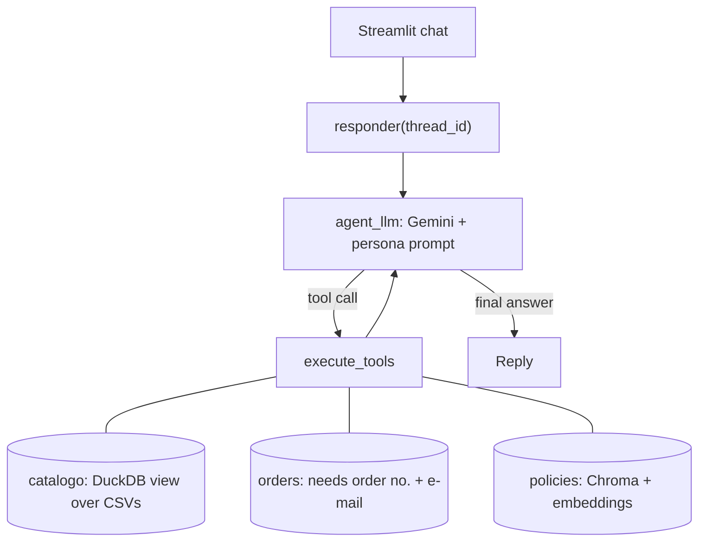

# Empório da Música: Customer Service Agent

A prototype customer-service agent for Empório da Música, a fictional musical-instrument store in Campo Grande, Brazil, built for the Artefact AI Engineer technical case. The agent speaks as the store's persona (in Portuguese, since its customers are Brazilian), queries **data** (prices, stock, promotions, orders) and **policies** (returns, payment, opening hours), and politely declines off-topic requests.

## Quick start

Requirements: Python 3.11 or newer (tested on Windows with Python 3.13 and 3.14) and a free [Google AI Studio](https://aistudio.google.com/apikey) API key.

```bash
git clone https://github.com/wallacemattos-dados/emporio_ai_agent.git
cd emporio_ai_agent
python -m venv venv
source venv/bin/activate            # Windows PowerShell: venv\Scripts\Activate.ps1
pip install -r requirements.txt
cp .env.example .env                # Windows PowerShell: Copy-Item .env.example .env
```

Edit `.env`:

```text
GOOGLE_API_KEY=your_api_key
LLM_MODEL=gemini-flash-latest
EMBEDDING_MODEL=gemini-embedding-001
```

Run the chat UI with `streamlit run frontend.py`. Run the tests (offline, no API key used) with `pip install -r requirements-dev.txt` and `python -m pytest -q`.

> **Free-tier note.** On the free tier, per-model daily limits are tight (e.g., `gemini-3.8-flash` allows only 20 requests per day). Each customer message costs 2–3 requests when a tool is used. If you hit HTTP 429, set `LLM_MODEL` to `gemini-3.5-flash-lite`, which offers a more generous free-tier quota of 15 RPM, 500 requests per day, and 250,000 TPM . Alternatively, switch to another model with remaining quota (see AI Studio → Rate limits) or enable billing. The first policy question is slower: the PDF is embedded once and cached in `storage/`.


## Architecture



A LangGraph state graph loops between the model and its tools. Conversations are persisted per `thread_id` in SQLite (`SqliteSaver`), so a conversation survives an app restart.

## Technical decisions

**Approach: function calling with a hybrid of SQL and RAG.** Transactional data (price, stock, orders) must be exact and changes often, so it is queried with SQL. Policies are prose, so they use retrieval. The LLM chooses the tool. Rejected: putting the CSVs and the PDF in the prompt (costly, imprecise, and unsafe for customer data).

**Model and provider: Google Gemini through AI Studio.** Chosen for its free tier and because one key covers both the LLM and the embeddings. Trade-offs: the `-latest` alias can change silently, which hurts reproducibility, and the free tier is quota-limited. Transient server errors (5xx) are retried with exponential backoff; 429 is deliberately **not** retried, since a daily quota will not recover in seconds.

**Data handling: a `catalogo` view that encodes the business rules.** The data has traps: products that are `active` with zero stock, `discontinued` products with stock, a "coming soon" product, and promotions with `is_active = 0`. The view defines `disponivel` as `status = 'active' AND stock > 0`, applies only promotions flagged active, and computes the PIX price (5%) only when no promotion is active, as the manual requires (item 6.2). The LLM queries a view that is already correct instead of re-deriving the rules every time.

**Retrieval: section-aware chunking, local Chroma, top-4.** The default `pypdf` extraction returns one word per line for this PDF, so the `layout` mode is used. The text is split by the manual's own headings (for example "4.1 Direito de Arrependimento") into 26 chunks, each prefixed with its section title; oversized sections go through `RecursiveCharacterTextSplitter`. The collection name includes the PDF hash and the embedding model, so changing either one triggers a fresh index.

**Prompt strategy.** The system prompt is built on every call and never stored in the history. It sets the tone (informal but professional, as the manual asks), makes tool use mandatory before any factual claim, encodes the promotion and availability rules, forbids revealing other customers' data, and treats user messages and tool results as data, not as instructions.

**Interface: Streamlit importing the graph directly.** The simplest setup for a prototype; no API layer.

## Security

By construction, independent of the prompt:

- All three tools are **read-only**: the agent cannot change any state (no cart, coupon, refund or address change), so a successful injection has nothing to modify.
- LLM-written SQL must be a single `SELECT`, runs in an ephemeral in-memory DuckDB with file access disabled, and the customers and orders tables are not loaded into it. Order lookups use a dedicated tool that needs the order number **and** the account e-mail, and answers identically for an unknown order and a wrong e-mail. Adversarial SQL attempts are covered by tests.

The agent was also tested manually with prompt-injection attempts: direct instruction overrides, multi-turn discount escalation (example 5), encoded text, fake tool-call text, and system-prompt extraction. In the cases tried there was no unwarranted discount, no disclosure of customer data and no change of behaviour. **This is not a guarantee:** it was one run per case, with a non-deterministic model and a small sample, and some scenarios used products that do not exist in the catalogue (refused by scope, not by a defence).

## Assumptions

- **The manual contradicts itself.** Phone: `(67) 3341-4444` (cover, item 1.2) versus `(67) 3321-4500` (item 7); I use the first. The e-mail appears with an accent (`empóriodamusica`), which is invalid; I use `contato@emporiodamusica.com.br`. Instalments: the table says a R$ 100 minimum up to 12x, while item 3.1 gives tiered minimums; I did not resolve this in code and the agent relies on the retrieved text (see example 3). The manual claims "300+ instruments" but the data has 65, so the agent never quotes that number.
- **There is no reliable "today"** (orders span Oct 2025 to Mar 2026), so the agent never calls an order "late".
- **The price paid is not stored** (`order_items` has no unit price, and two orders do not match current prices), so order totals come from `total_brl`.
- Order statuses are in English in the data and are translated for the customer.
- Two customers (11 and 43) share an e-mail; order verification still works because the e-mail is compared with the order's own customer.
- The brief suggests "tchê", an expression from Rio Grande do Sul; I use only an occasional "bicho".

## Known limitations and what I would do with more time

- Off-topic handling relies on the prompt (no semantic router), so every off-topic message still costs one LLM call and is not deterministic. Next: a semantic router at the entry point.
- There is no automated evaluation of the LLM's answers: unit tests use a fake LLM and answer quality was checked by hand. Next: a golden question set with expected answers, run in CI.
- SQL is written by the LLM and can be wrong (errors go back to the model for a retry).
- Order verification is order number plus e-mail, not real authentication.
- Vector search only (no hybrid search or reranking); the history grows without bound; a failed question stays in the thread; no streaming; SQLite and local Chroma do not scale to many users.
- No detection or alerting for injection attempts, only a per-turn log of the tools used.
- Cosmetic `nanobind` leak warnings from DuckDB 2.0 may appear when the process exits.
- Next: expose the data tools through an MCP server (the logic already lives in pure functions, separate from the `@tool` wrappers), add a FastAPI layer with streaming, and CI.

## Use of AI coding assistants

I used **Claude (Anthropic)** as a coding assistant throughout the project. I started by configuring it as a mentor: one code block at a time, each with a line-by-line explanation, trade-offs and verification questions that I had to answer before moving on. This produced the setup, the configuration module and the graph state. Because of the deadline I then asked for a faster mode, in which the assistant wrote the tools, RAG, prompt, graph, UI and tests together. I applied the code, ran the tests and the app on my machine, and reported the errors that appeared (for example a wrong PDF file name, 503 and 429 API errors, and missing imports), which were diagnosed and fixed with the assistant. The assistant also ran its code in its own sandbox with a fake LLM; that does not replace my runs against the real model. Design decisions (two data tools instead of one, dropping PydanticAI, removing redundant state fields, postponing the semantic router) were proposed with trade-offs and chosen by me. This README and the example generator were also drafted with the assistant.

## Example conversations

The `examples/` folder has five conversations (dialogues in Portuguese, the agent's audience; headers and notes in English):

1. `01_acoustic_guitars_under_1000.md`: catalogue search with a price ceiling.
2. `02_store_address_and_hours.md`: general store information from the policy manual.
3. `03_takamine_price_pix_installments.md`: price, PIX discount and 12x instalments (data plus policy; the inactive promotion is ignored).
4. `04_return_with_order_lookup.md`: right of withdrawal plus an order lookup (policy plus real-time data).
5. `05_prompt_injection_discount_escalation.md`: a five-turn attempt to obtain a fake 50% discount.

They were produced by running `python gerar_exemplos.py` against the real model; each file records the model, the tools used per turn and the response time, and the answers are saved verbatim.

## Project structure

```text
app/agent/          state.py, persona.py, graph.py
app/tools/          csv_analyzer.py (catalogue, orders), rag_policy.py (policies)
app/core/           config.py
data/               CSVs and the policies PDF
examples/           example conversations
tests/              offline tests (54)
frontend.py         Streamlit UI
gerar_exemplos.py   generates the example conversations from real runs
```